# UX Design

## Prototype

[Open the Figma prototype](https://www.figma.com/proto/VJx78oo7ZW7RwW59zypqZq/Anything-but-fish?page-id=0%3A1&node-id=23-13&starting-point-node-id=23%3A13)

The current prototype starts at the main screen. Some screens and interactions are still being completed.

[Editable Figma design](https://www.figma.com/design/VJx78oo7ZW7RwW59zypqZq/Anything-but-fish?node-id=0-1)

## App Map

The welcome screen leads to sign-up and login, with password recovery available from login. After logging in, the main screen leads to the game, NPC conversations, collections, and plot reference pages.

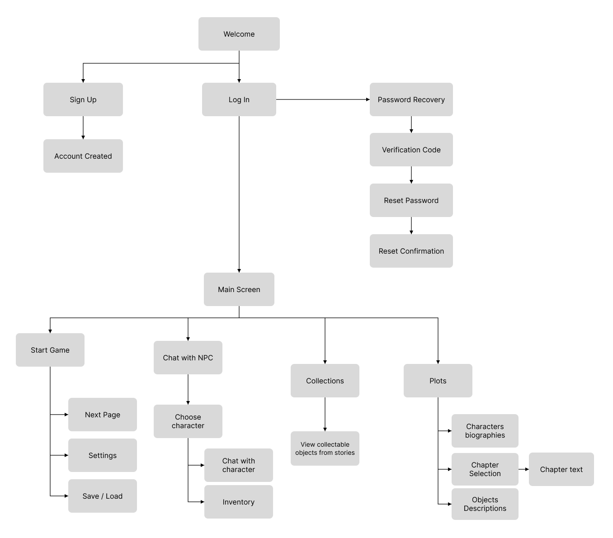

## Wireframes

The following screens are exported from the current Figma design at 402 × 874 pixels.

### Account access

#### Welcome

Choose whether to create an account or log in.

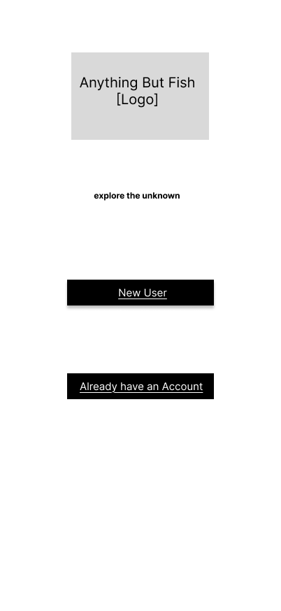

#### Log in

Enter a username and password, or open sign-up and password recovery.

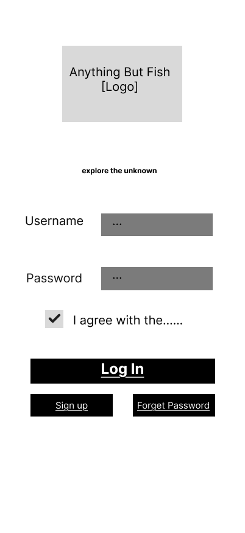

#### Sign up

Enter account details and confirm the password to create an account.

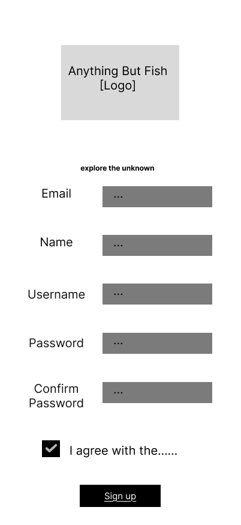

#### Account created

Confirm account creation and continue to the login screen.

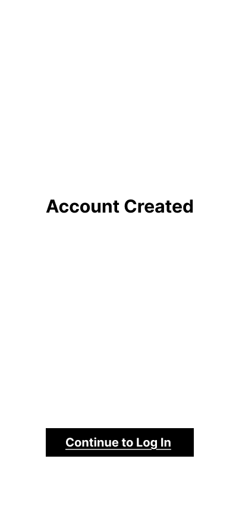

#### Password recovery email

Enter the email address used for password recovery.

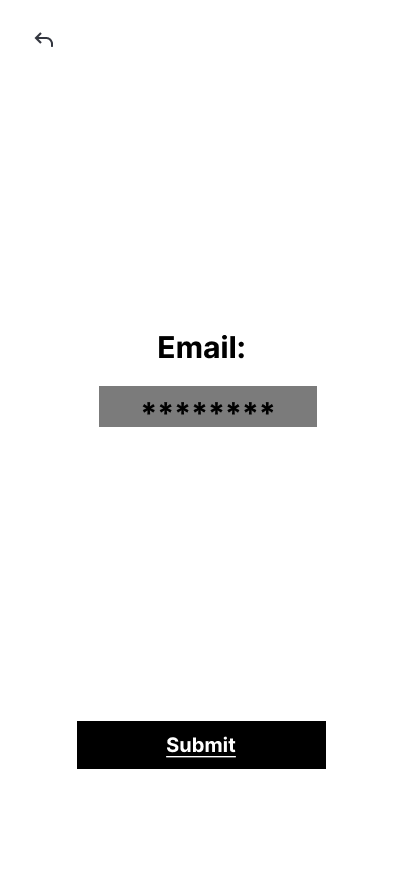

#### Verification code

Enter the verification code or request another code.

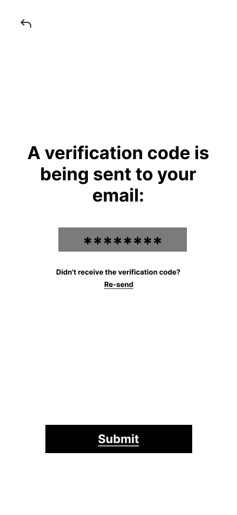

#### Code resent

Show confirmation after requesting another verification code.

#### Reset password

Enter and confirm a new password.

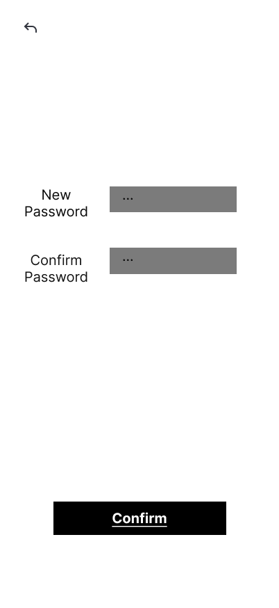

#### Password reset confirmation

Confirm the password change and return to login.

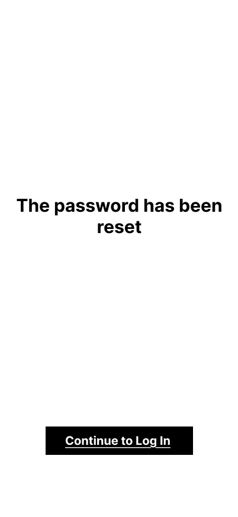

### Main screen and story

#### Main screen

Provide entry points for the game, NPC conversations, collections, plots, and settings, with a logout control.

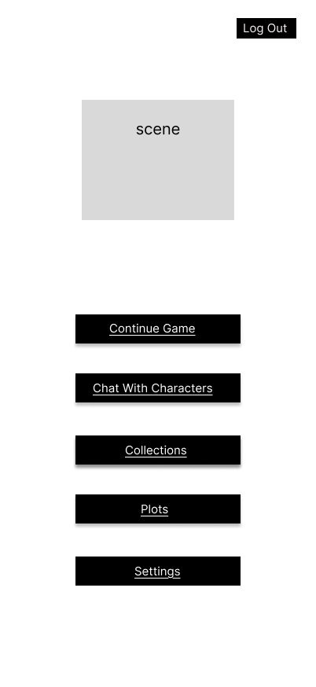

#### Story reader

Show an illustration placeholder above character dialogue and response choices. The bottom controls provide access to inventory, settings, Save / Load, and Next.

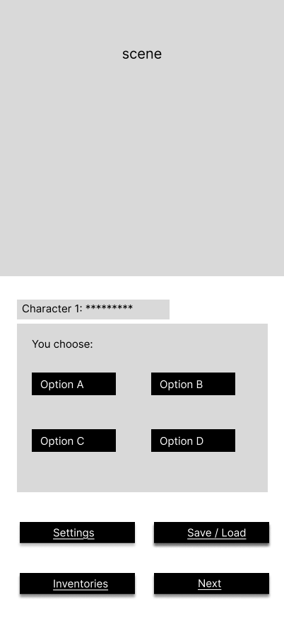

#### Inventory

Show numbered item selectors and an area for item information and stories.

#### Settings

Show volume and brightness controls, a dark-mode toggle, and back and exit controls.

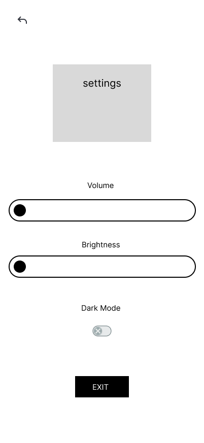

### NPC conversations

#### Chapter selection

Choose a chapter before selecting a character to chat with in the current prototype.

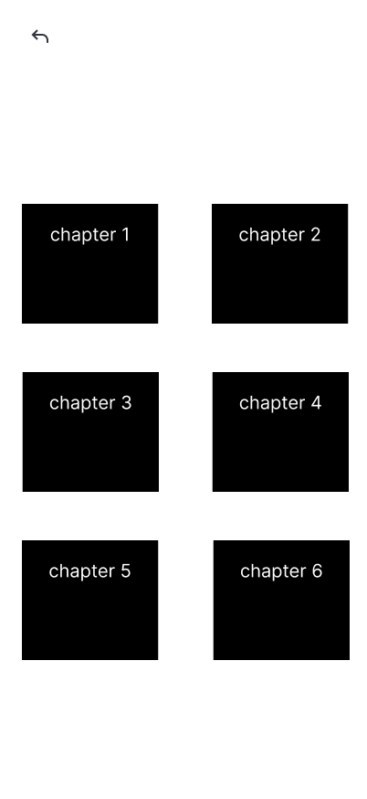

#### Character selection

Choose a character from the selected chapter to open a conversation.

#### NPC chat

Show a scene, conversation area, message field, and send control.

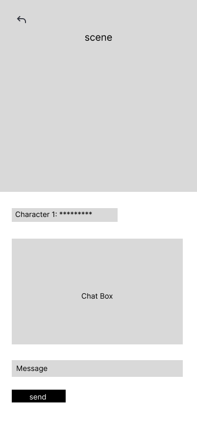

#### Chat after sending

Show example player and character messages and a sent confirmation.

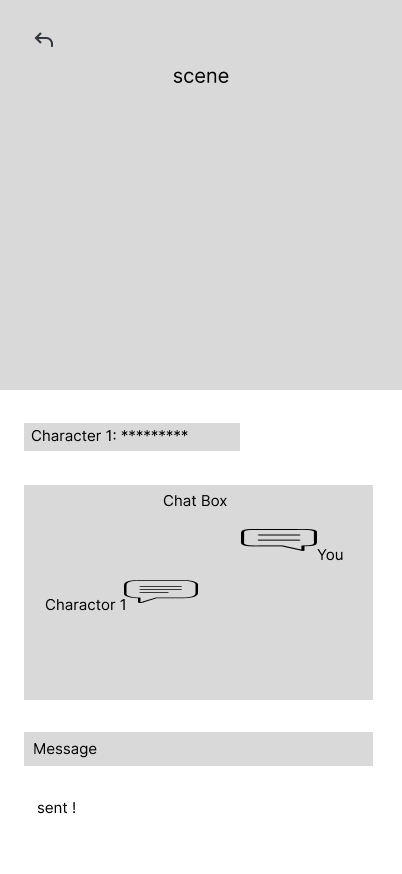

### Collections and reference pages

#### Collections

Show collected rewards and a grid of numbered collection entries.

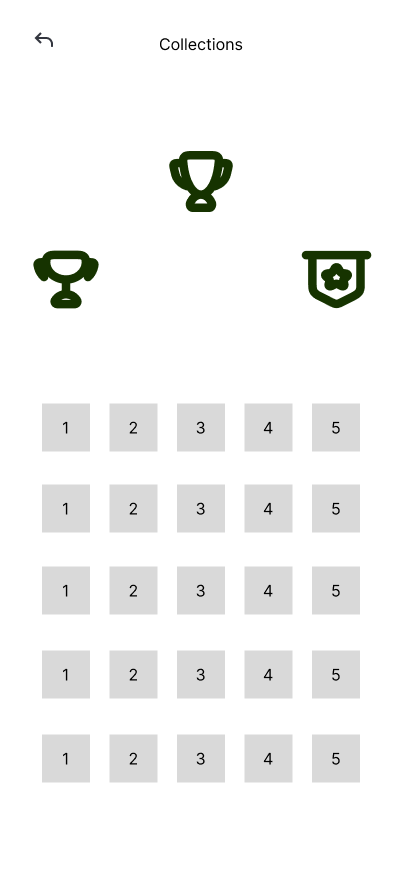

#### Plots

Show plot selectors and an information area, with a control for character biographies.

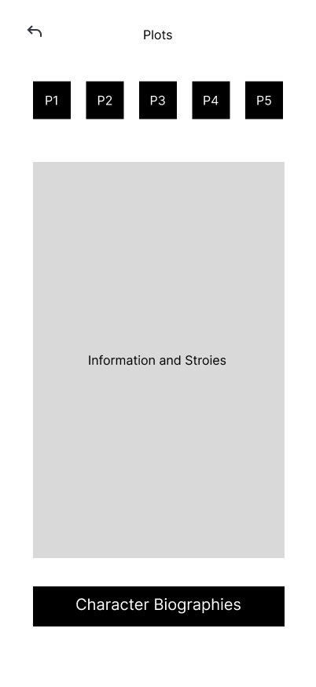

#### Character biographies

Show a character selection grid for browsing biographies.

#### Inventory — additional frame

An additional inventory frame currently present in the design, with numbered selectors and an information area.

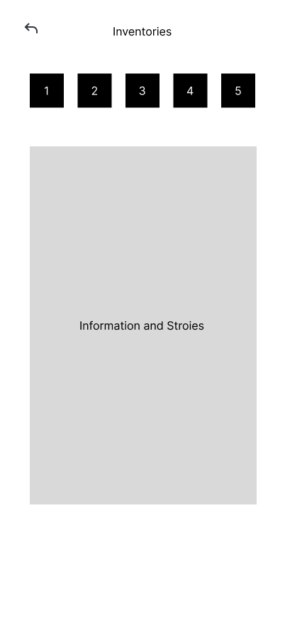

## To Finish

- Add the item-received and item-submission screens, including submission feedback, and a representative interactive story page.
- Complete and check the prototype navigation, including the main-screen Plots link, dialogue choices, Next, and Save / Load.
- Update the app map to match the final screens and navigation.
- Add the editable source-file exports and verify that anyone with the prototype link can view it.
